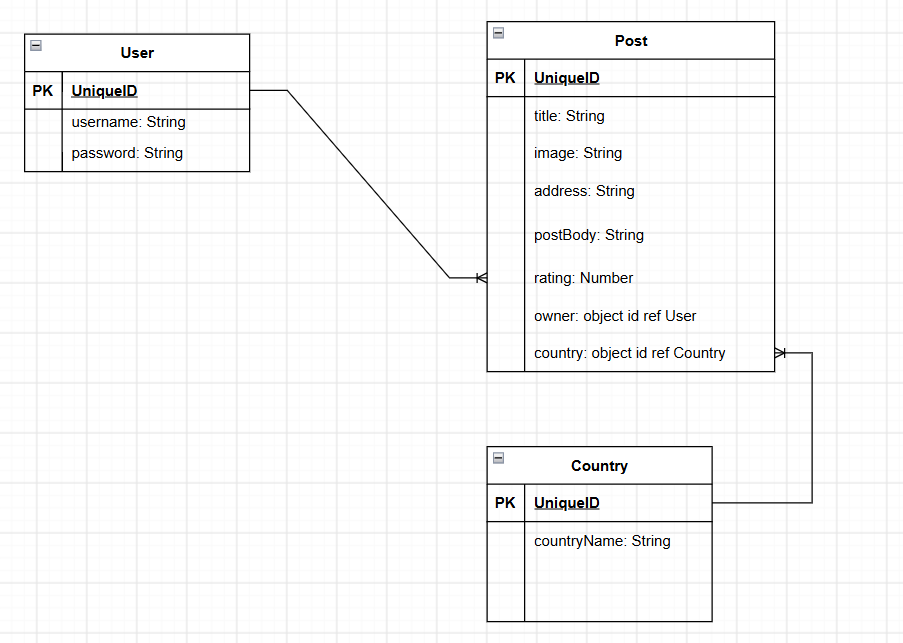

# Project Name
Places of Interest - Travel/Tourism board

## Overview

## Screenshots

## Technologies Used
1. Mongo DB
2. Express.js
3. Node.js

## Getting Started

## User Stories
1. as a user , I should be able to create a posting about a location
2. as a user, I should be able to view all location postings
3. as a user , I should be able to list my postings
4. as a user, I should be able to list the postings based on the associated country
5. as a user , I should be able to update my posting
6. as a user , I should be able to delete my posting
7. as a user, I should be able to put a rating for a post
8. as a user, I should be able to add an image for a post

## Database Design

## Routes

| Method | Route | Description |
|---------|-------|-------------|
| GET | / | Home page |
| GET | /posts | List all posts |
| GET | /post/new | New post form |
| POST | /posts | Create post |
| GET | /posts/:id | View post |
| GET | /posts/:id/edit | Edit post form |
| PUT | /posts/:id | Update post |
| DELETE | /posts/:id | Delete post |

## Features

## Future Enhancements

## Credits
1. https://gist.github.com/keeguon/2310008 Used for list of countries
2. Google search for the code to seed the country database (mongoose.connect , deletemany , insertmany)