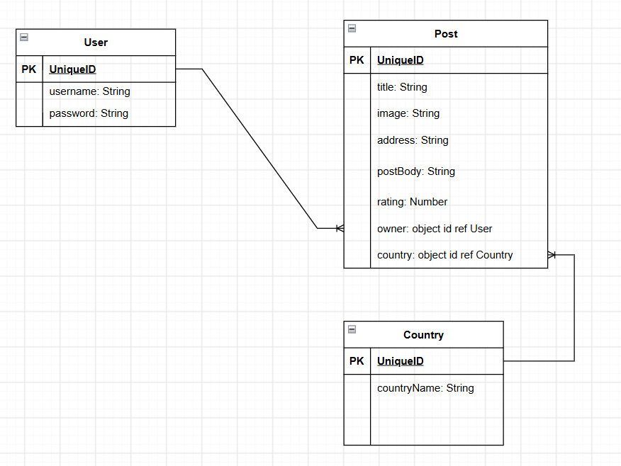

# Project Name
Places of Interest - Travel/Tourism board

## Overview

## Screenshots

## Technologies Used
1. Mongo DB
2. Express.js
3. Node.js
4. jQuery
5. Bootstrap 3

## Getting Started

## User Stories
1. As a user , I should be able to create a posting about a location.
2. As a user, I should be able to view all location postings.
3. As a user , I should be able to list my postings.
4. As a user, I should be able to list the postings based on the associated country.
5. As a user , I should be able to update my posting.
6. As a user , I should be able to delete my posting.
7. As a user, I should be able to put a rating for a post.
8. As a user, I should be able to add an image for a post.

## Database Design

## Routes

| Method | Route                        | Description                        |
|--------|------------------------------|------------------------------------|
| GET    | /                            | Homepage                           |
| GET    | /posts/new                   | New post form                      |
| POST   | /posts                       | create post                        |
| GET    | /posts                       | Show all posts                     |
| DELETE | /posts/:postId               | Delete a post                      |
| GET    | /posts/:postId/edit          | Edit post form                     |
| PUT    | /posts/:postId               | Submit post edit                   |
| GET    | /posts/country-list          | Show countries with existing posts |
| GET    | /posts/:postId               | Show post details                  |
| GET    | /posts/by-country/:countryId | Show posts for specefic country    |

## Features

## Future Enhancements

## Credits
1. https://gist.github.com/keeguon/2310008 Used for list of countries
2. https://www.w3schools.com
3. https://pixabay.com/videos/waterfall-river-view-nature-that-356398/ homepage background video by Engin_Akyurt
4. https://pixabay.com/photos/autumn-lake-trees-reflection-10545288/ autumn background for sign up by fietzfotos
5. https://pixabay.com/photos/mountains-snow-capped-peak-nature-10412381/ snow mountain background by AyşegülAytören
